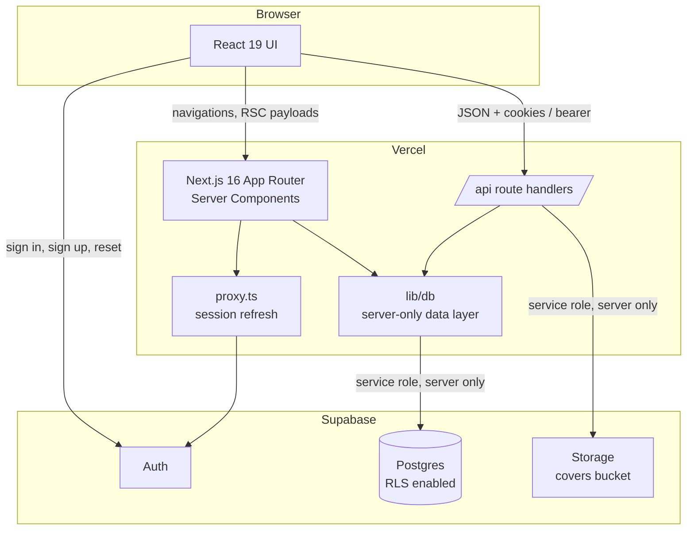
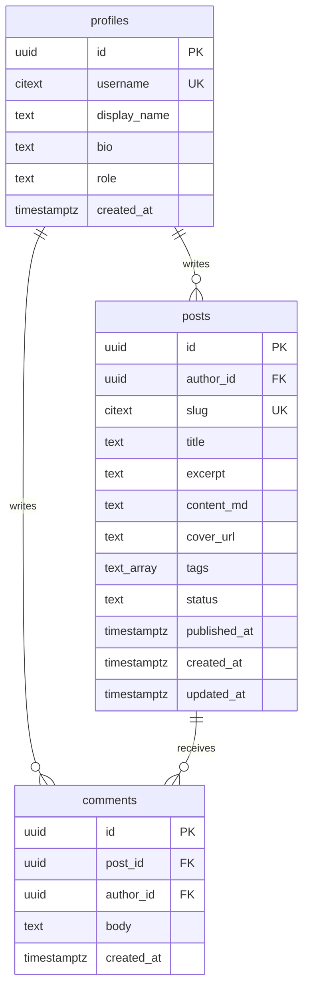

<div align="center">

# The Margin

**A small publication about attention, craft, and the web.**

Readers browse essays and leave notes in the margin. Writers publish with Markdown, covers, and tags.

[**Live site**](https://blog-website-nine-rose.vercel.app) · [**Source**](https://github.com/Kadhiravan06/Blog) · [**API**](https://blog-website-nine-rose.vercel.app/api/posts)

[](https://nextjs.org)
[](https://react.dev)
[](https://www.typescriptlang.org)
[](https://tailwindcss.com)
[](https://supabase.com)
[](https://vercel.com)
[](#testing)

</div>

---

## Overview

The Margin is a complete blogging platform, built as a portfolio-sized production app rather than a tutorial. It covers the full loop: sign up, write a draft, upload a cover, publish, read, comment, moderate, and delete.

The design takes its name seriously. A margin is a note left for the next reader — not a verdict machine. Comments are flat, oldest first, addressed to whoever comes after you. There are no likes, scores, or algorithmic feeds.

**What makes it different from a hosted blog:**

- **A real backend you own.** Postgres schema, row-level security, storage policies, REST endpoints, rate limits, and moderation are all in this repository.
- **One data layer, two consumers.** The same server-only query functions power both React Server Components and the public API, so behavior cannot drift between the page and the endpoint.
- **Serverless-safe by design.** Sessions refresh in the proxy, rate limits count database rows instead of process memory, and all reads are wrapped for Next.js Cache Components.
- **An editorial visual system.** A warm paper palette, a reading-first serif, and a rust accent — with dark mode, focus rings, and selection colors that belong to the same world.

## Features

| Area | What you get |
| --- | --- |
| **Auth** | Email/password sign-up and sign-in, password reset, cookie-based sessions refreshed in `proxy.ts` |
| **Writing** | Markdown editor with live preview, drafts, publish dates, tags, cover upload with preview |
| **Reading** | Paginated feed, tag filters, featured post, reading time, author pages, related metadata |
| **Notes** | Flat comments, oldest first, deletable by the commenter, the post author, or an admin |
| **Moderation** | Admin page for recent posts and comments, with permanent delete |
| **Profiles** | Public author pages, editable display name, username, and bio |
| **API** | REST endpoints for posts, comments, uploads, profile, and health, with a consistent error envelope |
| **Craft** | Light/dark theme, responsive layouts, accessible forms, keyboard focus, reduced-motion support |

## Architecture



**Request flow for a page:** the proxy refreshes the session cookie, the Server Component reads the viewer, the shared data layer queries Postgres with the service role, and the result streams into a Suspense boundary. Drafts are filtered by the same permission helper the API uses.

**Request flow for a mutation:** the client posts JSON to `/api/*`, the handler authenticates via cookie or bearer token, validates with Zod, checks the rate limit, enforces ownership, then writes and returns the mapped object.

## Tech stack

| Layer | Choice | Why |
| --- | --- | --- |
| Framework | Next.js 16.4 App Router | Server Components, Cache Components, route handlers, proxy |
| UI | React 19 + Tailwind CSS 4 | Fast iteration, design tokens via CSS variables |
| Language | TypeScript (strict) | Typed rows, inputs, and API contracts |
| Database | Supabase Postgres | Managed Postgres with RLS and generous free tier |
| Auth | Supabase Auth + `@supabase/ssr` | Cookie sessions that work in Server Components |
| Storage | Supabase Storage | Public covers, writes only through the service role |
| Validation | Zod | One schema shared by forms and endpoints |
| Content | `react-markdown` + `remark-gfm` | Safe Markdown rendering with tables and task lists |
| Tests | Vitest | Fast unit tests for the logic that can break silently |
| Hosting | Vercel Hobby | Zero-config deploys and a daily cron |

## Getting started

**Requirements:** Node 22+, npm, and a free Supabase project.

```bash
git clone https://github.com/Kadhiravan06/Blog.git
cd Blog
npm install
```

### 1. Create the database

1. Create a project at [supabase.com/dashboard](https://supabase.com/dashboard).
2. **Authentication → Sign In / Providers → Email**: turn **off** “Confirm email” for instant sign-up.
3. **SQL Editor**: paste [`supabase/migrations/0001_init.sql`](supabase/migrations/0001_init.sql) and run it. This creates the tables, constraints, indexes, triggers, deny-all RLS, and the public `covers` bucket.

### 2. Configure the environment

```bash
cp .env.example .env.local
```

Fill in the values from **Project Settings → API**:

```bash
NEXT_PUBLIC_SUPABASE_URL=https://<project>.supabase.co
NEXT_PUBLIC_SUPABASE_ANON_KEY=<anon key>
SUPABASE_SERVICE_ROLE_KEY=<service role key>   # server-only
NEXT_PUBLIC_SITE_URL=http://localhost:3000
SEED_PASSWORD=<password for the demo accounts>
```

> `SUPABASE_SERVICE_ROLE_KEY` bypasses RLS. It must never reach the browser, a client component, or a commit.

### 3. Seed and run

```bash
npm run seed   # idempotent: 3 authors, 6 essays, 13 notes
npm run dev    # http://localhost:3000
```

The seed creates `ada@demo.blog`, `marcus@demo.blog`, and `june@demo.blog` using `SEED_PASSWORD`. The first account is an admin. Re-running the seed is safe: existing users and posts are left alone.

## Database schema



Highlights:

- **`citext` slugs and usernames** make uniqueness case-insensitive without lowercasing on every read.
- **Check constraints** enforce title length, slug shape, excerpt length, tag count, comment length, and the publish-date invariant (`published_at` is set if and only if the post is published).
- **Triggers** maintain `updated_at` and create a profile automatically when an auth user is inserted.
- **RLS is enabled with no policies** as a deny-all backstop; every read and write goes through the server-side service role.
- **Indexes** cover the feed (`status, published_at desc`), author listings, and comment threads.

## API

All mutations accept either the session cookie or `Authorization: Bearer <access_token>`. Errors share one envelope:

```json
{
  "error": {
    "code": "validation_failed",
    "message": "Some fields need attention.",
    "fields": { "title": "Too small: expected string to have >=3 characters" }
  }
}
```

| Method | Route | Auth | Notes |
| --- | --- | --- | --- |
| `GET` | `/api/health` | — | Queries Postgres; used by the daily Vercel cron |
| `GET` | `/api/posts?page=&tag=` | — | Published feed, 6 per page |
| `POST` | `/api/posts` | user | Create draft or published; 3 per minute |
| `GET` | `/api/posts/:slug` | optional | Drafts visible only to author/admin |
| `PATCH` | `/api/posts/:slug` | author/admin | Partial update; deletes replaced covers |
| `DELETE` | `/api/posts/:slug` | author/admin | Cascades comments and removes the cover |
| `GET` | `/api/posts/:slug/comments` | optional | Oldest first, 50 per page |
| `POST` | `/api/posts/:slug/comments` | user | 5 per minute |
| `DELETE` | `/api/comments/:id` | commenter / post author / admin | |
| `POST` | `/api/uploads` | user | Multipart `file`, ≤2 MB, JPEG/PNG/WebP by magic bytes |
| `PATCH` | `/api/profile` | user | Username, display name, bio |

### Example

```bash
# Public feed
curl https://blog-website-nine-rose.vercel.app/api/posts?page=1

# Authenticated draft
curl -X POST https://blog-website-nine-rose.vercel.app/api/posts \
  -H "Authorization: Bearer $ACCESS_TOKEN" \
  -H "Content-Type: application/json" \
  -d '{"title":"A draft from the API","contentMd":"Hello, margin.","status":"draft"}'
```

## Security model

| Risk | Mitigation |
| --- | --- |
| Privilege escalation through RLS | RLS enabled with zero policies; the service role is used only in server modules |
| Key leakage | The service role key is read from `process.env` in server-only files and never imported by a client component |
| Malicious uploads | Size cap, magic-byte sniffing, MIME allowlist, UUID keys, server-generated storage writes |
| XSS through Markdown | `react-markdown` renders without raw HTML; external links get `rel="noreferrer noopener"` |
| Open redirects | `safePath` accepts only same-origin paths for `next=` parameters |
| Abuse | Per-user database-window rate limits (3 posts/min, 5 comments/min) |
| Cross-site uploads | Origin check against `NEXT_PUBLIC_SITE_URL` |

## Testing

```bash
npm test        # 28 unit tests
npm run lint
npm run typecheck
npm run build
```

| Suite | Covers |
| --- | --- |
| `tests/slug.test.ts` | Unicode slugging, length caps, collision suffixes |
| `tests/permissions.test.ts` | Draft visibility, edit rights, comment deletion rules |
| `tests/validation.test.ts` | Post, comment, and profile boundaries |
| `tests/images.test.ts` | Magic-byte detection and rejected formats |
| `tests/http.test.ts` | Error envelope, JSON parsing, cover URL trust, safe paths |

The smoke script exercises a running deployment:

```bash
BASE_URL=https://blog-website-nine-rose.vercel.app \
SMOKE_EMAIL=ada@demo.blog \
SMOKE_PASSWORD="$SEED_PASSWORD" \
npm run smoke
```

It checks health, the public feed, sign-in, and an authenticated create → read → delete cycle.

## Project structure

```text
app/
  (auth)/            sign in, sign up, forgot, reset
  admin/             moderation desk
  api/               REST handlers
  authors/[username] public author pages
  dashboard/         your drafts and published posts
  posts/[slug]/      article + edit
  settings/          profile settings
  write/             new essay
components/          design system and feature components
lib/
  db/                server-only queries and row mappers
  supabase/          browser, cookie, admin clients + proxy
  auth.ts            viewer resolution and guards
  permissions.ts     pure authorization rules
  validation.ts      Zod schemas
  rate-limit.ts      database-window limits
  storage.ts         cover upload/delete
  images.ts          magic-byte sniffing
supabase/migrations/ schema, triggers, RLS, bucket
scripts/             seed and smoke test
tests/               Vitest suites
```

## Deployment

1. Push the repository to GitHub.
2. In **Vercel → New Project**, import the repo. The Next.js preset is detected automatically; the Hobby plan is enough.
3. Add the environment variables from `.env.local`. Set `NEXT_PUBLIC_SITE_URL` to the stable production domain (not the per-deployment hash URL).
4. Deploy, then run `npm run seed` locally against the same Supabase project if you want demo content.
5. In **Supabase → Authentication → URL Configuration**, set the Site URL to the Vercel domain and add `https://<domain>/auth/callback` as a redirect URL.
6. Run the smoke test against production.

`vercel.json` schedules a daily request to `/api/health`. Because the endpoint queries Postgres, it keeps a free Supabase project from pausing after a week of inactivity.

## Design decisions

- **Editorial, not dashboard.** The reading experience leads: a serif body face, generous measure, quiet rules, and tags that read like filing marks. Writing tools stay out of the way until you need them.
- **The margin metaphor is structural.** Comments sit under the piece, flat and oldest first. Deletion is framed as moderation, not punishment.
- **One source of truth for permissions.** `lib/permissions.ts` is pure and tested; pages and API handlers both call it.
- **Errors are part of the interface.** API errors carry a code, a human message, and per-field details; forms surface all three.
- **Progressive enhancement where it matters.** Pages are server-rendered; only forms and toggles ship JavaScript.
- **No invented data.** Seeded essays and notes are clearly demo content. The interface never fabricates testimonials, metrics, or customers.

## Known limits

These are deliberate scope choices for a portfolio build:

- Password-reset emails only reach the project owner until a custom SMTP domain is verified. Sign-up and sign-in work for everyone.
- Rate limits are counted from recent rows, so two simultaneous requests can both pass.
- No threaded replies, likes, search, avatars, or user administration. Flat notes, oldest first.
- The free Supabase tier is a demo environment: 500 MB database, 1 GB storage, two projects.
- Covers are optional; posts without one use the typographic fallback.

---

<div align="center">

Built with Next.js, Supabase, and a preference for fewer, better features.

</div>
